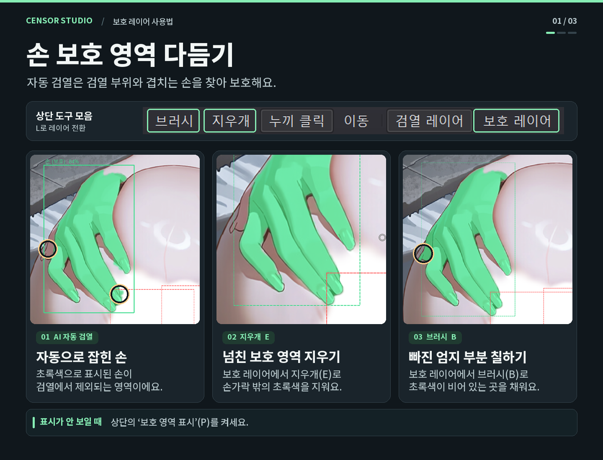
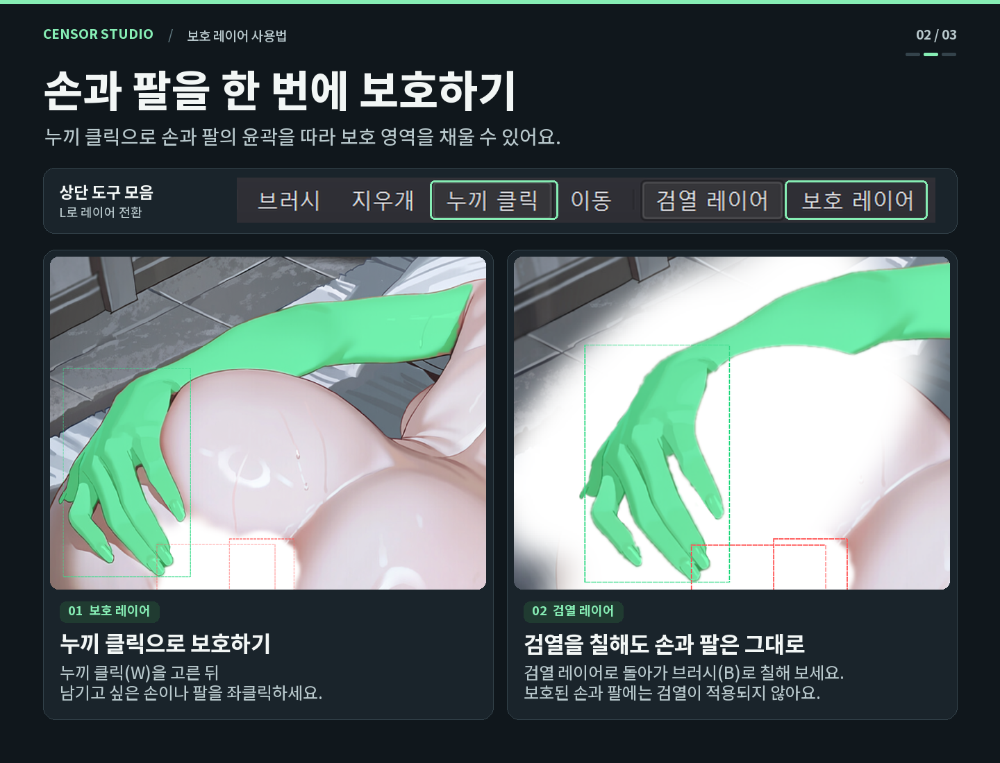
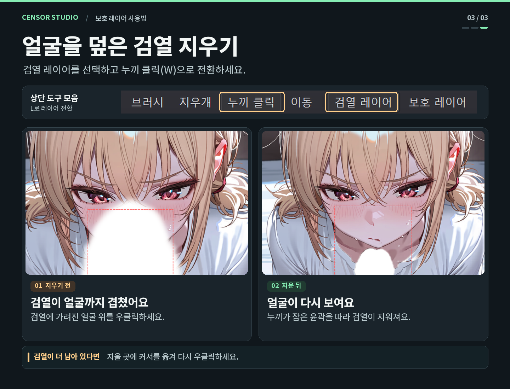
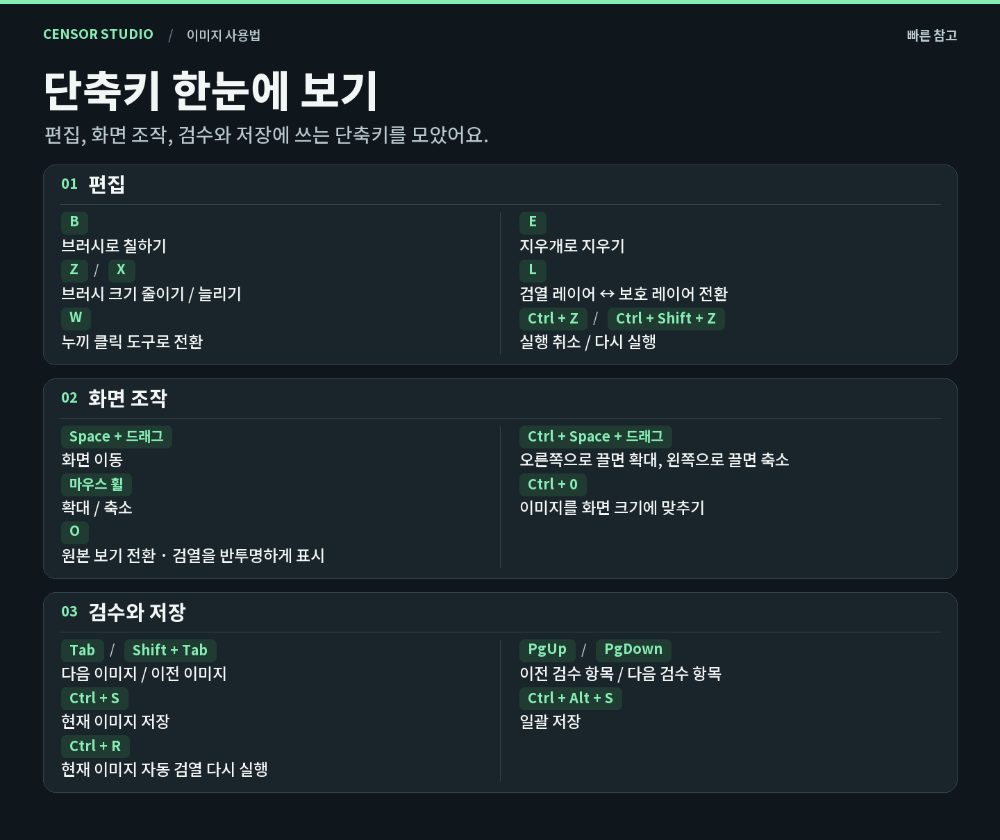

# Censor Studio

아니메 이미지를 자동으로 검열하고, 하나씩 확인하면서 손으로 다듬는 Windows용 프로그램입니다.
모든 처리는 내 PC에서 이루어지며 이미지는 어디로도 전송되지 않습니다.

## 다운로드

**[CensorStudio-Setup-1.1.0.exe 내려받기](https://github.com/DarrnB/censor-studio/releases/latest/download/CensorStudio-Setup-1.1.0.exe)**

다른 버전은 [릴리스 목록](https://github.com/DarrnB/censor-studio/releases)에서 받을 수 있습니다.

- Windows 10 / 11 (64비트)
- 설치 파일 하나로 끝납니다. Python 등을 따로 설치할 필요가 없습니다.
- 서명이 없는 파일이라 실행할 때 Windows 경고가 뜰 수 있습니다. "추가 정보 → 실행"을 누르면 됩니다.
- 처음 이미지를 넣을 때 AI 모델(약 400MB)을 내려받습니다. 이때만 인터넷이 필요합니다.

## 기본 작업 순서

1. 이미지를 창에 끌어다 놓습니다. 여러 장이나 폴더째로 넣어도 됩니다.
2. 자동 검열이 돌아갑니다. 탐지된 부위에 브러시가 칠해지고, 겹치는 손은 자동으로 남깁니다.
3. 덜 가려진 곳은 브러시로 칠하고, 과하게 가려진 곳은 지우개로 지웁니다.
4. Tab으로 다음 이미지로 넘어갑니다.
5. 다 끝나면 "일괄 저장"을 누릅니다. 원본 폴더 안의 `censored` 폴더에 같은 파일 이름으로 저장됩니다.

## 사용법

### 손 보호 영역 다듬기

### 손과 팔을 한 번에 보호하기

### 얼굴을 덮은 검열 지우기

### 단축키 한눈에 보기

## 단축키

| 키 | 기능 |
|---|---|
| B / E | 브러시 / 지우개 |
| Z / X | 브러시 작게 / 크게 |
| W | 누끼 클릭 |
| L | 검열 레이어 ↔ 보호 레이어 전환 |
| O | 원본 보기 (검열을 반투명하게) |
| Space + 드래그 | 화면 이동 |
| Ctrl + Space + 드래그 | 확대(오른쪽) / 축소(왼쪽) |
| 마우스 휠 | 확대 / 축소 |
| Ctrl + 0 | 화면 맞춤 |
| Tab / Shift + Tab | 다음 / 이전 이미지 |
| PgUp / PgDown | 이전 / 다음 검수 항목 |
| Ctrl + Z / Ctrl + Shift + Z | 실행취소 / 다시실행 |
| Ctrl + S | 지금 이미지 저장 |
| Ctrl + Alt + S | 일괄 저장 |
| Ctrl + R | 지금 이미지 자동 검열 다시 실행 |
| F11 | 전체화면 |

## 알아둘 점

- 자동 검열이 잡는 부위는 유두, 음경, 음부, 항문, 음모입니다. 음모는 기본으로 꺼져 있습니다. 그 밖의 부위는 직접 칠해야 합니다.
- 자동 결과는 꼭 한 번씩 확인하세요. 손이 부위를 감싸 쥔 경우, 쥔 부위가 손과 함께 보호되어 노출될 수 있습니다.
- 설정과 브러시 프리셋은 `%APPDATA%\CensorStudio`에 저장됩니다.
- 최초 설정으로 원본 보기가 켜져 있습니다. 검열이 투명한건 정상입니다. 저장되는 결과물을 보려면 원본보기를 해제해주세요.

## 사용 모델과 출처

이 프로그램은 아래 모델을 **포함하지 않습니다.** 처음 실행할 때 각 저장소에서 직접 내려받아 내 PC에서만 실행합니다.
모델의 저작권과 라이선스는 각 제작자에게 있습니다.

| 용도 | 모델 | 제작 | 라이선스 (저장소 표기) |
|---|---|---|---|
| 검열 부위 탐지 · 윤곽 | [01miku/anime-nsfw-segm-yolo26](https://huggingface.co/01miku/anime-nsfw-segm-yolo26) (`nsfw-anime-medium-x1280.onnx`) | 01miku | MIT (모델 파일의 메타데이터에는 Ultralytics YOLO의 AGPL-3.0 표기가 있습니다) |
| 손 탐지 | [deepghs/anime_hand_detection](https://huggingface.co/deepghs/anime_hand_detection) (`hand_detect_v1.0_s`) | DeepGHS | OpenRAIL |
| 누끼 (윤곽 따기) | [onnx-community/sam2.1-hiera-small-ONNX](https://huggingface.co/onnx-community/sam2.1-hiera-small-ONNX) | ONNX Community 변환, 원본은 Meta의 [SAM 2.1](https://github.com/facebookresearch/sam2) | Apache-2.0 (원본 SAM 2 기준) |

모델 구조의 원본:

- [Ultralytics YOLO](https://github.com/ultralytics/ultralytics) — 탐지 모델의 구조 (AGPL-3.0)
- [Segment Anything Model 2](https://github.com/facebookresearch/sam2) — Meta AI (Apache-2.0)

## 사용 라이브러리

- [PySide6 (Qt for Python)](https://doc.qt.io/qtforpython-6/) — LGPL-3.0
- [ONNX Runtime (DirectML)](https://github.com/microsoft/onnxruntime) — MIT
- [OpenCV](https://opencv.org/) — Apache-2.0
- [NumPy](https://numpy.org/) — BSD-3-Clause
- [huggingface_hub](https://github.com/huggingface/huggingface_hub) — Apache-2.0
- [Pillow](https://python-pillow.org/) — MIT-CMU
- [PyInstaller](https://pyinstaller.org/) · [Inno Setup](https://jrsoftware.org/isinfo.php) — 패키징
